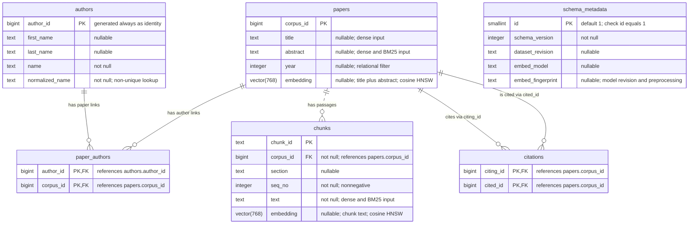

# Database ER diagram (D-24)

This diagram describes the project database model.
The implemented table names, types and constraints come from
[schema.sql](../docker/db/schema.sql). Existing databases receive the embedding
fingerprint through [migration 001](../docker/db/migrations/001_embedding_fingerprint.sql).
See the [database contract](database_contract.md) for retrieval and ingestion rules.

## Relationships and constraints

- `||` means exactly one; `o{` means zero or many. Every author link, citation
  endpoint and chunk references exactly one existing parent row. A paper can have
  no author links, citations or chunks; an author can have no paper links.
- Papers and authors have a many-to-many relationship through `paper_authors`.
  Its primary key is the pair `(author_id, corpus_id)`.
- Citations form a directed many-to-many relationship between papers.
  `citing_id` identifies the paper making the citation; `cited_id` identifies the
  referenced paper. Their pair is the primary key, preventing duplicate edges.
- A paper has zero or many chunks. The dotted relationship means `corpus_id` is
  not part of the chunk primary key. `UNIQUE (corpus_id, seq_no)` makes sequence
  numbers unique within a paper, and `CHECK (seq_no >= 0)` rejects negative values.
- Author names, including `normalized_name`, are not unique identifiers.
- `schema_metadata` has no foreign keys. `CHECK (id = 1)` permits at most one row;
  schema initialization inserts that row with `schema_version = 1`.
- Primary-key columns are implicitly non-null. Other non-null and nullable
  columns are marked in the diagram. Embeddings may be null before D-14 runs.

## Vector, sparse and relational storage

The table below describes the checked-in embedding and index scripts, rather
than asserting that these indexes have been installed in a particular database.

| Data | Vector representation | Sparse or relational indexes |
| --- | --- | --- |
| Paper title and abstract | Joined with a line break into one `papers.embedding`, 768 dimensions; cosine HNSW | BM25 on abstract; title has B-tree expression indexes and a GIN trigram index |
| Chunk text | One `chunks.embedding` per chunk, 768 dimensions; cosine HNSW | BM25 on `chunks.text` |
| Paper year | None | B-tree; also included in the paper BM25 index for filtering |
| Authors and paper-author links | None | Primary keys, foreign keys, normalized-name lookup and reverse paper-author lookup |
| Citation links | None | Composite primary key plus reverse citation lookup |
| Chunk identity and order | None | Primary key and unique `(corpus_id, seq_no)` index; `corpus_id` is also included in the chunk BM25 index |
| Build metadata | None | Primary key on the singleton row |

Embedding preprocessing is implemented in
[embedding.py](../src/scilitrag/data/embedding.py). HNSW and relational lookup
indexes are defined in [indexes.sql](../docker/db/indexes.sql); BM25 indexes are
defined in [retrieval_indexes.sql](../docker/db/retrieval_indexes.sql).

