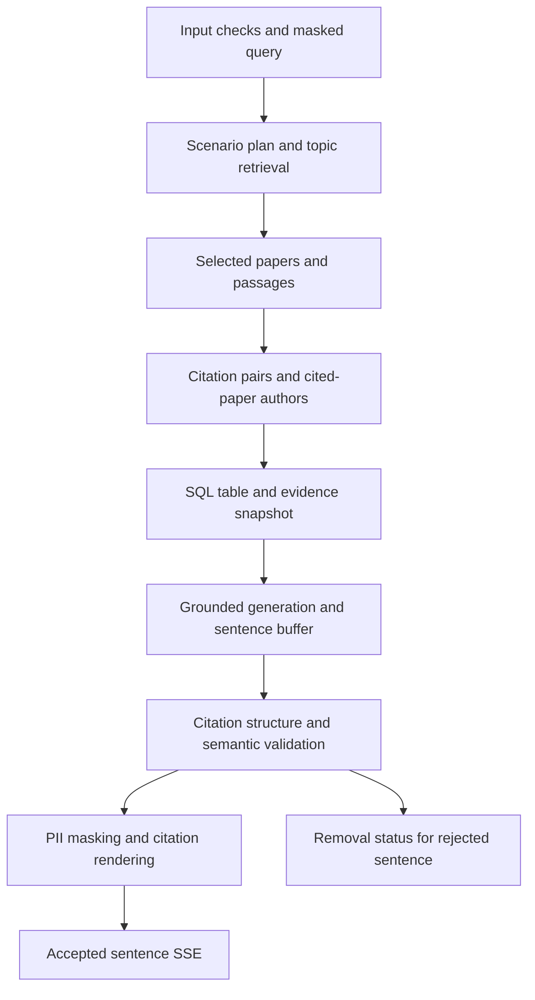

# Multi-hop execution and citation flow

An S3 question combines semantic topic search with relational citation traversal. The input
layer checks and masks the query before planning. The planner selects S3 and reconciles
explicit user filters. Filtered dense and BM25 searches identify topic-paper seeds, and
scoped passage retrieval supplies the context for paper summaries.

SQL consumes the exact previously retrieved seed IDs and follows outgoing citation edges
to cited papers and their stored author IDs. Distinct citation pairs give every cited-paper
coauthor full credit. The code renders counts and examples with their scope, parameters,
dataset revision and query ID. The model sees paper/passage context and writes summaries;
it does not generate the author-count table. Name normalization and extraction limits in
the [author review](d08_author_review.md) still apply to those stored identities.

Request-local labels bind statements to source snapshots. SQL evidence appends after the
paper/passage evidence, preserving existing labels. Complete generated sentences must pass
label syntax, membership and placement checks, the selected semantic validator, PII masking
and deterministic citation rendering before release. Failed sentences produce removal
statuses. Citation objects retain corpus/chunk or SQL identity, title, year, section, source
text and a fingerprint. The UI resolves SQL query IDs to their exact tables and parameters.

Cancellation closes the provider stream; controlled retrieval, entity and model failures
become terminal error events. A successful request ends with stage timing, TTFT and sentence
validation counters. Existing token-rate telemetry counts streamed text deltas. Use engine
metrics for actual token throughput and hardware benchmarks.

This describes implemented control flow. The current snapshot still needs the real data
embedding adapter/index handoff and real semantic guardrail integration. Mock checks prove
routing, source identity and event order; they do not prove semantic faithfulness. Add real
measurements and reviewed examples when incorporating this flow into the technical report.

Design choices:

- Citation links and mentions supply candidate papers; explicit experimental passages and
  reviewed semantic support are additionally needed for baseline-use claims.
- SQL uses the already selected seed set and renders numerical facts in code, avoiding
  model arithmetic and a second retrieval with a changing scope.
- Evaluation separates citation structure from semantic support and leaves unreviewed
  quality unset. Reference counts require compatible corpus revision and seed identities.
