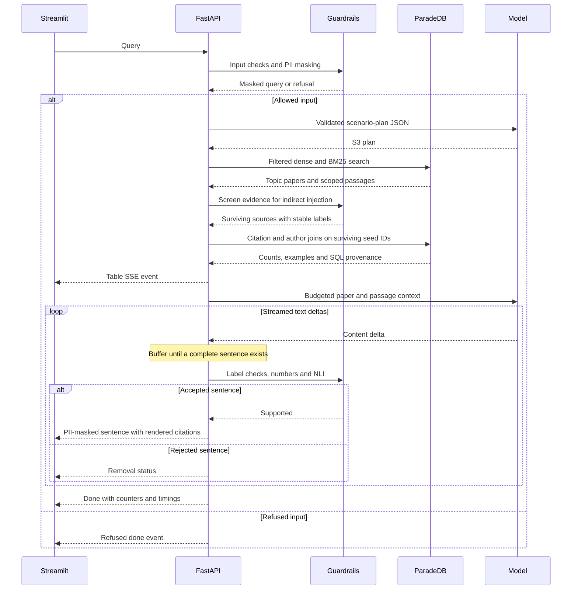

# Multi-hop execution and citation flow

For S3, a query such as “Rank the most cited authors for dense passage retrieval”
combines semantic topic search and relational citation traversal. The following flow
matches `api/pipeline.py`, `rag/generation.py` and `rag/scenarios/authors.py`.

## Scope of the SQL hop

The input component reports Prompt Guard, topic/write-intent classification and PII
stages. A refused input stops before planning or database access. Planning produces strict
JSON and reconciles explicit year/result constraints. Dense and BM25 search select topic
paper seeds and passages. The evidence guard then removes flagged sources before SQL and
generation. The SQL adapter's `with_evidence` hook consumes those surviving paper IDs;
there is no second semantic search and no global request cache.

SQL follows outgoing citation edges from those seeds to cited papers and their stored
author IDs. Each distinct (citing paper, cited paper) pair gives every cited-paper coauthor
full credit. Self-citations remain included. Counts sort descending, then by author name
under PostgreSQL C collation and author ID. The author filter restricts credited authors.
Year filters concern the citing seeds, not the cited examples. These are counts within the
selected seed set and dataset, not global bibliometric totals. Stored-identity limitations
from the [author review](d08_author_review.md) still apply.

`SqlFacts` records the counting rule, seed IDs, bound parameters, dataset revision, SQL,
rows and content-derived query ID. Its table is emitted before generated sentences and
appended as SQL evidence without changing existing labels. The generation prompt excludes
SQL tables: code supplies the counting-rule sentence and the model summarizes papers.

## Text-delta and sentence handoff (O10)

The provider's SSE frames become content deltas in `ChatClient.stream`. `generate_with`
can also supply code-generated SQL/abstract-only framing. `SentenceBuffer` holds unfinished
text until the splitter recognizes a complete sentence, or flushes a punctuated final tail.
A trailing citation after punctuation is valid buffering syntax; a citation without sentence
punctuation remains a fragment. The pending-character limit, provider truncation, malformed
frames and premature stream end produce controlled errors. Character budgets do not prove
that a prompt fits a model's tokenizer/context window.

The pipeline checks each complete sentence in this order:

1. Citation label syntax, request-local membership and trailing placement.
2. The selected `check_sentence`: numerical consistency; for non-SQL sources, the configured
   NLI validator. SQL-only evidence receives the numerical check. WP3 owns those policies
   and thresholds; buffering does not bypass or weaken them.
3. PII masking and deterministic citation rendering for accepted sentences.
4. A `sentence` SSE event for the UI, or a `generate` removal status for rejected text.

Raw provider deltas and rejected sentence text are not emitted as answer sentences. A later
error can follow already accepted sentences; the client must treat that answer as partial.
Closing the request cancels the producer and closes its async generation stream. Database
reads have their own statement timeout; cancellation does not turn separate reads into a
transaction-wide snapshot. Evaluation requires an actually frozen, versioned corpus.

## Citation Engine

`EvidenceIndex` defensively copies sources and requires unique positive request-local
labels and valid source identities. Filtering can leave label gaps. SQL snapshots append
above the current maximum label. `build_context` preserves labels, source fingerprints and
excerpt-truncation flags under character/per-item budgets; document content is untrusted data.

After validation, the renderer resolves each label to corpus/chunk or SQL identity, title,
year, section, author IDs and full source text. The SHA-256 fingerprint covers source content
and metadata, excluding the request label and ranking score. The UI drawer uses a SQL query
ID to resolve the exact emitted table, parameters and scope. Label validity is structural;
semantic and per-reference support are assessed separately.

## Evidence and timing limits

`tests/rag/test_guarded_stream.py` exercises the real HTTP parser, generation, numeric/NLI
validator code and renderer with controlled HTTP responses and NLI probabilities. Other
tests cover evidence screening, cancellation and source identity. These are integration
checks of control flow, not measured semantic acceptance with real model inference.
Use the [evaluation workflow](evaluation.md) for real S1/S2/S3 runs and source-bound human
reviews. Independent S3 references use the recorded SQL scope; S2 baseline use needs a
reviewed experimental passage, beyond a citation link or mention.

Saved runs include wall/component times on failures as well as success. The legacy API
`ttft_engine_ms` is measured from pipeline entry to the first generation delta, which can
be application framing; `ttft_user_ms` ends at the first released sentence, not the first
table. The API's `tokens` and `tokens_per_s` count text deltas, including code framing.
Use WP4's `bench/benchmark.py` for engine TTFT, true provider-token throughput and device
measurements. The report text describes this implementation; measured candidate results
and the joint model decision remain open until real runs and reviews are available.
